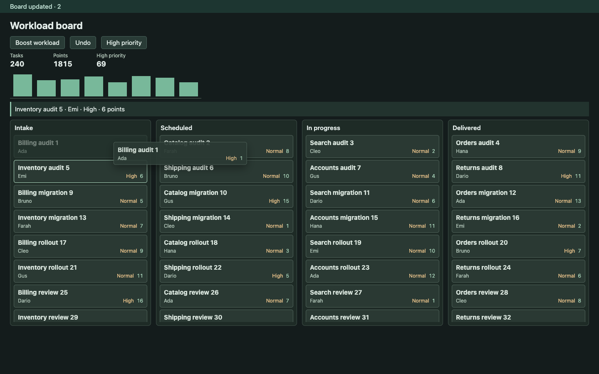

# Rendering a project board and a million-record grid

These benchmarks exercise two different screens. The project board measures cold startup, state changes, a cross-lane drag and the resulting animation. The telemetry grid measures how much work it takes to mount data-bearing components, update sparse records and scroll to the final record. The [single-record editor](SABA_FRAMEWORK_COMPARISON.md) remains a separate workload.

Measured before 2026-11-25. The compiler now lowers some keyed and checkbox lists and element-or-nothing holes to direct DOM code, which may change the compiled Saba figures below. They are kept as recorded until new measurements replace them. All runs used Chromium.

## Project board

The board mounts 240 cards across four independently scrollable lanes. Each card displays a title, owner, priority and estimated points. The screen also includes a toolbar, three summary counters, an eight-bar workload chart and a selected-card inspector. Every adapter starts from the same empty document host, viewport and stylesheet.

Each measured visit performs this sequence using trusted Chromium pointer inputs.

1. Open the board and wait for the initial committed state to paint.
2. Select card 5. Check the inspector and selected card.
3. Update 48 cards in one action. Each gains three points and changes priority. Check the cards, chart and counters.
4. Undo the batch. Check that the original data, order and aggregates return.
5. Filter to the 35 high-priority cards, then restore all 240.
6. Drag card 1 across the board and drop it before card 2. Check the new lane sizes of 59, 61, 60 and 60 and the final order. A pointer-following copy follows the drag. Visible displaced cards and the moving card animate to their new positions over a configured 300 ms.

After every step the driver checks every attached card in DOM order, including cards below the visible part of a lane, the inspector, membership, selection, undo availability, chart values and totals. An Element Timing marker becomes visible after each commit. Navigation-to-ready and input-to-paint times end at this marker's Chromium presentation timestamp. Drop-to-first-paint and drop-to-settled-paint have separate clocks. The compositor trace counts presented frames from the commit to animation completion, using headless Chromium presentation feedback. Frame spacing and initial/final gaps are retained per visit. Those frames describe the virtual display on this machine.

The current Saba entry uses the checkout's JSX and component mount functions. The planned Saba entry uses handwritten templates, signals and keyed bindings representing compiler output. React, Solid and Svelte use native keyed components. Vanilla uses keyed DOM updates. These six compute the board in the browser. The htmx adapter sends each operation to an independent in-memory board on the local server and morphs a compressed HTML response with Idiomorph. Its timings include the request and fragment processing. The fixture uses synthetic data and a loopback Node server to isolate browser rendering. [Workload and animation](../benchmarks/frameworks/rich/dashboard.js) · [Browser driver](../benchmarks/frameworks/rich/measure.mjs) · [Presentation trace](../benchmarks/frameworks/rich/presentation.mjs)



On the constrained profile, the planned Saba prototype opened in 344 ms, with vanilla at 328 ms and React at 484 ms. For a drop the order changed. The first committed state painted in 74.6 ms for the prototype, 69.7 ms for vanilla and 60.7 ms for React. Restoring 205 cards after filtering took 85.5 ms for the prototype and 111.9 ms for current Saba. These seven-visit medians describe this board and leave small differences unresolved.

Dashboard times are medians in milliseconds from seven measured visits per implementation per profile. One warm-up per implementation preceded those visits. Over seven measured rounds each implementation ran in every execution position. Both profiles used full Chromium 145.0.7632.6 on an Apple M1 Max with a 1,440 × 900 viewport and a fresh browser context per visit. Constrained applied 4× CPU throttling and 60 ms network latency, with 10 Mbps down and 2 Mbps up.

### Desktop dashboard

| Implementation | Board ready | Select | Batch 48 | Undo | Filter to 35 | Restore 240 | Drop to first paint | Drop to settled paint |
| --- | ---: | ---: | ---: | ---: | ---: | ---: | ---: | ---: |
| Current Saba | 96.0 | 61.0 | 27.8 | 27.7 | 29.1 | 37.2 | 32.3 | 331.0 |
| Planned Saba prototype | 76.0 | 60.8 | 28.7 | 27.1 | 28.3 | 27.8 | 30.6 | 328.9 |
| Vanilla JS | 76.0 | 53.7 | 27.7 | 26.9 | 28.1 | 29.1 | 35.6 | 331.6 |
| Solid | 84.0 | 54.2 | 28.8 | 26.7 | 27.9 | 34.3 | 29.7 | 330.8 |
| React | 124.0 | 56.9 | 28.1 | 28.1 | 27.9 | 31.5 | 30.1 | 331.1 |
| Svelte | 96.0 | 59.6 | 28.7 | 27.5 | 29.0 | 36.1 | 28.8 | 328.8 |
| htmx + Idiomorph | 108.0 | 43.8 | 44.2 | 45.7 | 34.5 | 49.0 | 53.6 | 355.0 |

### Constrained dashboard

| Implementation | Board ready | Select | Batch 48 | Undo | Filter to 35 | Restore 240 | Drop to first paint | Drop to settled paint |
| --- | ---: | ---: | ---: | ---: | ---: | ---: | ---: | ---: |
| Current Saba | 356.0 | 79.5 | 48.5 | 47.4 | 67.6 | 111.9 | 70.5 | 390.5 |
| Planned Saba prototype | 344.0 | 77.5 | 48.8 | 49.0 | 44.8 | 85.5 | 74.6 | 391.7 |
| Vanilla JS | 328.0 | 87.3 | 46.4 | 45.1 | 45.1 | 86.3 | 69.7 | 384.3 |
| Solid | 372.0 | 87.0 | 52.8 | 48.9 | 42.8 | 92.9 | 64.7 | 378.7 |
| React | 484.0 | 89.2 | 57.3 | 51.1 | 47.3 | 91.7 | 60.7 | 376.2 |
| Svelte | 404.0 | 78.5 | 51.2 | 45.7 | 44.0 | 93.6 | 60.2 | 379.1 |
| htmx + Idiomorph | 456.0 | 173.3 | 166.1 | 169.6 | 128.1 | 195.7 | 203.2 | 503.2 |

### Presented frames during the 300 ms animation

Each cell gives the median number of presented frames and the median longest interval between successive presented frames in a visit. Counts exclude the time before the drop commits. Initial and tail gaps are available in the raw trace summaries. Chromium’s headless virtual display supplies the feedback.

| Implementation | Desktop frames | Desktop longest gap | Constrained frames | Constrained longest gap |
| --- | ---: | ---: | ---: | ---: |
| Current Saba | 35 | 16.7 ms | 30 | 16.7 ms |
| Planned Saba prototype | 35 | 16.7 ms | 33 | 16.7 ms |
| Vanilla JS | 36 | 16.7 ms | 33 | 16.7 ms |
| Solid | 36 | 16.7 ms | 31 | 16.7 ms |
| React | 36 | 16.7 ms | 33 | 16.7 ms |
| Svelte | 35 | 16.7 ms | 34 | 33.3 ms |
| htmx + Idiomorph | 34 | 16.7 ms | 31 | 16.7 ms |

[All dashboard visits, frame timestamps and build hashes](benchmarks/rich-dashboard.json)

## Telemetry grid

Each record has an ID, a group and a mutable score. There are eight grid columns. Each visit allocates the entire data set, then mounts cells that display the ID and score. A verified completed visit changes every 97th record plus the final record, checks the full data set and its checksum, scrolls to the bottom and hit-tests the last cell against its expected text. The user actions and mount use Element Timing markers for presentation. The mount clock starts at data creation after the framework is loaded.

- **10,000 mounted components.** All cells stay connected. The driver checks initial layout, a sparse update and the final visible cell.
- **1,000,000 records with a windowed view.** All million records exist in memory. The 416-pixel scroll viewport shows 16 rows at a time. The original `virtual` comparison uses two extra rows on each side and mounts 144 cells at the top. The current `buffered` scenario starts with 192 cells and moves the mounted range when it approaches an edge. Both change 10,311 records, including the last cell.
- **1,000,000 mounted component target.** Mount connected components in bands of up to 4,096 without removing earlier bands. Force layout of the most recently mounted cell, confirm DOM count at checkpoints, and record when a visible status marker is presented. A watchdog samples the dedicated browser renderer process from outside the page. A stopped attempt reports the last confirmed layout count, the last checkpoint with presentation feedback, the stop reason and sampled peak memory. The viewport still paints only its visible area.

The capacity test covers the six client component implementations. htmx's server-fragment approach is exercised on the board. The grid starts the clock after client code has loaded and uses local records. The board startup clock includes the document, style and production bundle. [Cell and grid code](../benchmarks/frameworks/rich/scale.js) · [Capacity driver](../benchmarks/frameworks/rich/scale-run.cjs)

With one million local records and 144 mounted cells at the top of the grid, planned Saba reached its first verified view in **70.8 ms** and painted an update to 10,311 records in **43.9 ms**. Mounting all million cells took **15.5 s** and the same update took **1.34 s** in the full-capacity trial. Sampled peak renderer RSS rose from **232 MiB** in the windowed view to **4.93 GiB** with every cell connected. All six client implementations completed the higher-memory trial. A single full-capacity run per implementation establishes whether the workload completed and the order of magnitude of its cost. The small timing differences between frameworks need further repetitions.

### 10,000 fully mounted cells

Desktop medians from six fresh Chromium processes per implementation, three in each run. RSS is the median sampled peak of the renderer processes, including their baseline.

| Implementation | Initial marker painted | Sparse update painted | Final row jump painted | Peak RSS |
| --- | ---: | ---: | ---: | ---: |
| Current Saba | 211.9 ms | 59.2 ms | 34.0 ms | 242 MiB |
| Planned Saba prototype | 157.2 ms | 59.0 ms | 29.9 ms | 234 MiB |
| Vanilla JS | 145.6 ms | 57.6 ms | 26.9 ms | 221 MiB |
| Solid | 162.8 ms | 61.6 ms | 30.8 ms | 237 MiB |
| React | 163.1 ms | 67.8 ms | 28.3 ms | 233 MiB |
| Svelte | 172.5 ms | 63.3 ms | 27.6 ms | 239 MiB |

### 1,000,000 records with the original two-row overscan

Desktop medians from six fresh Chromium processes per implementation, three in each run. RSS is the median sampled peak of the renderer processes, including their baseline.

| Implementation | Initial marker painted | Sparse update painted | Final row jump painted | Peak RSS |
| --- | ---: | ---: | ---: | ---: |
| Current Saba | 73.9 ms | 51.0 ms | 29.1 ms | 234 MiB |
| Planned Saba prototype | 70.8 ms | 43.9 ms | 27.6 ms | 232 MiB |
| Vanilla JS | 69.6 ms | 44.3 ms | 27.3 ms | 231 MiB |
| Solid | 71.5 ms | 44.1 ms | 28.9 ms | 233 MiB |
| React | 77.1 ms | 44.7 ms | 26.8 ms | 238 MiB |
| Svelte | 74.9 ms | 46.6 ms | 27.7 ms | 233 MiB |

### Buffered scrolling

The buffered scenario uses the same keyed renderer and one million local records. It initially mounts eight extra rows on each available side. It starts replenishing the band when three rows of runway remain, coalesces normal boundary crossings into one animation frame, and fills immediately if another scroll step of the same size could expose missing rows.

Four matched rounds ran 82 scripted positions with reversals, 12 trusted wheel inputs including 32-row steps, a resize from 416 to 728 px, and a jump to the last edited record. Both implementations used fresh Chromium processes. Each sampled frame hit-tested the cells at the four corners of the viewport against their expected identities and displayed scores.

| Median per visit, 82-position scroll | Original two-row overscan | Buffered |
| --- | ---: | ---: |
| Window reconciliations | 82 | 13 |
| Total synchronous window work | 9.35 ms | 4.25 ms |
| Positions extending outside the previous window before scroll handling | 8 | 0 |
| Peak cells mounted on this trace | 168 | 256 |
| p95 main-thread animation-frame interval | 9.30 ms | 9.25 ms |

On the separate wheel sequence, four of the 12 inputs outran the buffered range before the handler. The handler filled the destination before the next sampled frame. Across the scripted, wheel and jump segments, each implementation recorded zero uncovered viewports in 460 main-thread frame samples. The buffered window also covered the enlarged viewport without another scroll event and retained all 208 overlapping cell elements in the identity check. Compositor presentation, network latency and physical-display perception are outside these measurements. [Full visits and fixture hashes](benchmarks/renderer-window-scroll.json)

### Attempts under a 2 GiB renderer ceiling

Each implementation attempted to keep a million cells mounted twice, with 2 GiB sampled renderer RSS, 1,400 MiB V8 old space and a 100-second deadline per visit. Every attempt reached the RSS guard. Ranges show the two runs. The last confirmed counts are lower bounds on progress when the guard fired. RSS can overshoot between 200 ms samples.

| Implementation | Last layout-confirmed cells | Last count with a presented marker |
| --- | ---: | ---: |
| Current Saba | 311,296–315,392 | 294,912 |
| Planned Saba prototype | 348,160–356,352 | 327,680 |
| Vanilla JS | 413,696 | 393,216 |
| Solid | 401,408–405,504 | 393,216 |
| React | 401,408–417,792 | 393,216 |
| Svelte | 393,216–401,408 | 360,448–393,216 |

Between runs the driver added an option to allow a higher memory ceiling on machines with sufficient physical memory. Both runs used the same 2 GiB setting, workload, assets and rendered content. [First scale run](benchmarks/rich-scale.json) · [Repeated scale run](benchmarks/rich-scale-repeat.json)

### Higher-memory million-component trial

Each implementation ran once more with a 6 GiB renderer RSS ceiling, 3 GiB V8 old-space ceiling and 150-second deadline. Only one renderer ran at a time on the 32 GiB host. A completed visit mounted one million components with data and text, updated 10,311 records, and scrolled to the checked final tile. Seconds to mount include creating the data and the checkpointed layout. Update and scroll times end at the presentation marker.

| Implementation | Outcome | Last layout count | Mount to paint | Update to paint | Jump to paint | Sampled peak RSS |
| --- | --- | ---: | ---: | ---: | ---: | ---: |
| Current Saba | completed | 1,000,000 | 21.5 s | 1430 ms | 139 ms | 5.62 GiB |
| Planned Saba prototype | completed | 1,000,000 | 15.5 s | 1341 ms | 171 ms | 4.93 GiB |
| Vanilla JS | completed | 1,000,000 | 14.5 s | 1324 ms | 140 ms | 4.53 GiB |
| React | completed | 1,000,000 | 14.1 s | 1470 ms | 130 ms | 4.62 GiB |
| Solid | completed | 1,000,000 | 14.0 s | 1268 ms | 131 ms | 4.87 GiB |
| Svelte | completed | 1,000,000 | 14.9 s | 1463 ms | 127 ms | 4.89 GiB |

[Higher-memory trials and individual checkpoints](benchmarks/rich-scale-high.json)

The [follow-up on the losses to React](SABA_RENDERER_LOSSES.md) isolates cross-lane DOM moves, text bindings at one million cells, and the jump to the final row.

## Reproduce

Use Node 22 or newer, npm, an installed Playwright package and its full Chromium browser. Set `PLAYWRIGHT_PATH` if Playwright is installed outside the project's module search path. The Taskfile installs the locked build dependencies and builds the selected workload. Keep output from separate experiments at distinct paths.

```sh
task bench:dashboard -- --trials 7 --profiles desktop,constrained --out /tmp/rich-dashboard.json
task bench:scale -- --scenarios moderate,virtual,capacity --trials 3 --rss-mib 2048 --old-space-mib 1400 --seconds 100 --out /tmp/rich-scale.json
task bench:window -- /tmp/saba-window-scroll.json
task bench:scale -- --scenarios capacity --rss-mib 6144 --old-space-mib 3072 --seconds 150 --out /tmp/rich-scale-high.json
```

To explore a board yourself after building the dashboard, run `node benchmarks/frameworks/rich/server.mjs` from the repository root and open one of the seven printed URLs.
