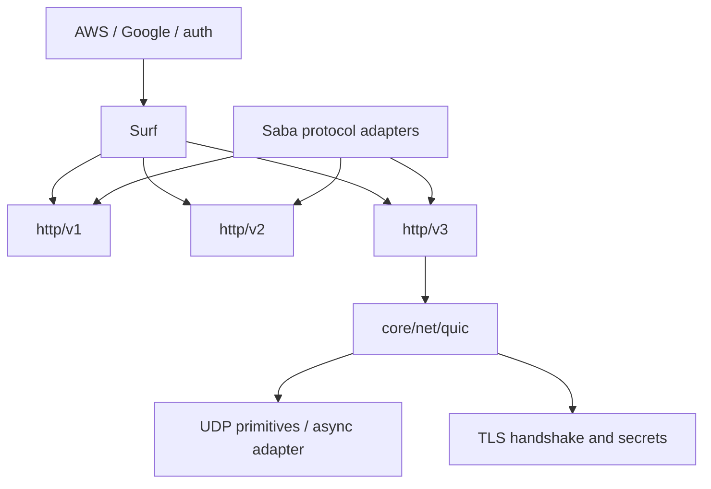

# A reusable native Odin web stack

> This accepted decision is retained as the historical design. Its planned/status
> language describes that checkpoint, not today's implementation inventory. See
> the [current distribution and ownership guide](../WEBTOOLS_DISTRIBUTION.md) and
> the dated implementation addendum below before selecting APIs or claiming support.

Accepted 2026-11-06. Tracking: [OKAMI-95](https://linear.app/devoured/issue/OKAMI-95).

Webtools will share native protocol and client implementations across applications. Surf owns reusable outbound HTTP behavior; AWS, Google and auth own their service behavior. QUIC belongs in the networking layer, and HTTP versions belong in the shared HTTP library. Saba exposes a lean server core with optional integration adapters and a convenience facade. This trades external transport implementations for direct ownership of protocol correctness, interoperability and maintenance.

## Package ownership

| Package | Owns | Does not own |
| --- | --- | --- |
| `core:net` | Socket/network primitives and existing connection interfaces | Importing optional QUIC implementation |
| `core:net/quic` (planned) | Native QUIC packets, connections, streams, recovery, congestion and transport security integration above UDP | HTTP, Saba routing or client request policy |
| `core:crypto/tls` | Native TLS authentication, handshake state and secrets; TCP record processing remains distinct | HTTP or application service credentials |
| `shared:http` | Common HTTP request/header/status and URL semantics | Importing all protocol versions |
| `shared:http/v1` | HTTP/1 wire parsing, serialization and chunked framing | Server routing or client pooling |
| `shared:http/v2` (planned) | Shared native HTTP/2 and HPACK protocol state | A separate implementation for each host |
| `shared:http/v3` (planned) | Shared native HTTP/3 and QPACK above QUIC streams | QUIC packet recovery or UDP polling |
| `shared:surf` | Native HTTP/WebSocket client integration, origin-aware pooling, deadlines, trust configuration and bounded streaming | AWS signing, Google token policy or Saba dependencies |
| `shared:aws`, `shared:google`, `shared:auth` | Their service-specific operations and explicit injected dependencies | Duplicated native HTTP clients |
| `shared:saba/core` (planned) | Request dispatch and server lifecycle with narrow handler interfaces | Importing optional service/application adapters |
| Saba adapter packages (planned) | Integrating shared protocols, auth, assets, pages, development and S3 with server handlers | Duplicating protocol codecs or service signing |
| `shared:saba` | A documented convenience facade and migration path | A guarantee that every optional dependency is absent |

The diagram shows protocol usage, not a requirement for every codec to drive sockets. HTTP/3 consumes QUIC stream/events through its integration seam; I/O execution and worker ownership stay explicit. QUIC uses TLS handshake/key events and packet protection, not TCP TLS records sent over UDP.

Applications select optional adapters by importing their packages and explicitly registering them. The core imports no adapters. Runtime configuration controls included behavior; it cannot remove a transitive import from the build. Verify omission through the dependency graph, symbols and linked libraries, rather than assuming either all imported code is retained or unused-code elimination guarantees optionality.

## Public lifecycle contracts

These are design requirements for the corresponding implementation tickets, not interfaces already shipped.

- **Exchange:** one application request/response lifetime, independent of a TCP connection or QUIC stream. Multiplexed connections may own several exchanges. Cancellation and request memory must not outlive their explicit owner.
- **Owned chunk:** bytes plus the operation/context that releases their backing storage. Whole-chunk acceptance clears the caller's source; rejection/backpressure preserves it. Every accepted chunk is released exactly once, including reset, error and shutdown. An allocator or pool backing it must survive until release. Copying an Odin struct does not enforce move-only ownership; aliases remain a caller obligation.
- **Release versus delivery:** local acceptance, storage release and peer acknowledgment are separate facts. QUIC retains a retransmission-capable representation until permitted to discard it. Never retain an entire request arena accidentally for a single borrowed body. A bounded-copy convenience interface remains available; ownership transfer does not promise zero copies during encryption/packet construction.
- **Session executor:** current thread-confined TLS callbacks and migratable tasks require an explicit serialized ownership seam. Preserve whole-connection work on its owning worker where possible; do not introduce a global I/O owner as an implicit default.
- **Request budget:** one absolute deadline spans DNS/connect, TLS, redirects and body transfer. Document non-preemptible work and cancellation latency. Bound bytes, streams and blocking jobs separately from connection metadata capacity.
- **Errors and replay:** transport outcomes identify the failing phase and whether a write's effect is uncertain. Service callers own replay policy; connection failure must not silently retry an ambiguous email, POST or PATCH.
- **Credentials:** AWS signing accepts explicit credentials/time. Google token ownership and serialized/concurrent use are documented. Expiring providers use bounded refresh and safe snapshots when implemented; no live credentials are required for fixtures.

## Native QUIC milestones

1. **Packet/vector foundation:** deterministic clock and packet injection; published encoding/protection vectors, packet-number spaces, malformed-input bounds and allocator-failure evidence. No HTTP dependency.
2. **Authenticated QUIC v1 handshake:** client/server CRYPTO reassembly, transport parameters, TLS authentication/ALPN, encryption levels, key discard and packet protection. Test independent peers and bounded handshake/anti-amplification behavior.
3. **Reliable bounded transport:** stream/connection flow control, ACK/loss detection, PTO and congestion control, reset/close/drain, idle timers and owned-data release. Exercise loss, reordering, duplicates, stalls and cancellation under memory budgets.
4. **Interoperability gate:** independent peers on Darwin and Linux, supported architectures/toolchain pairs recorded, security review and sanitizer/fuzz regressions. Unsupported migration/version policies are explicit and must preserve required address validation.
5. **HTTP/3 integration:** one `http/v3` implementation, bounded QPACK/blocked streams, with separate Surf and Saba adapters. Preserve application semantics and safe client fallback.

Initial target: QUIC v1, native client and server foundations, Darwin/Linux with architecture coverage certified by actual runs. The current local run is Darwin only; Linux support is not certified by typechecking. Session resumption and 0-RTT are later work; 0-RTT remains disabled until applications have an explicit replay policy. External QUIC bindings, curl multi and edge termination are not alternative implementation commitments in this roadmap.

## Validation and maintenance

The clean executable consumer gate in the parent Odin checkout (`ci/WEBTOOLS_TOOLCHAIN.md`) records compiler identity, source revision, compiler digest and loaded LLVM identity before running library fixtures. A typecheck is not an executable pass; compiler failures, skips and unsupported platforms are separate outcomes. Offline credentials, fake HTTP peers, independent protocol vectors, loss/timer simulation, allocation failure and teardown tests precede broader load claims. Benchmark changed paths with repeated connection-load cells, tail latency, throughput, CPU and retained/live memory; do not adopt queue/slab/pool alternatives from source inspection alone.

Native QUIC ownership includes tracking protocol errata, independent interoperability, crypto review, malformed-input regression coverage and security fixes. Existing TLS primitives can be reused, but reuse does not certify the new handshake integration. No production QUIC claim follows from these package decisions.

## Migration status

The Surf rename/import updates, removal of the `shared/transport` alias package, and extraction of HTTP/1 into `shared/http/v1` have been made. The `v2` and `v3` directories currently document planned work. Owned-chunk transfer, native QUIC, the Saba core/facade extraction and the new TLS seam remain implementation tasks. AWS/Google dependency repairs and HTTP/1 parity are separately verified before being called complete. Preserve application-specific Mesa adaptations and owned source provenance; this decision introduces no new licensing requirement.

References: [QUIC](https://www.rfc-editor.org/rfc/rfc9000.html), [QUIC recovery](https://www.rfc-editor.org/rfc/rfc9002.html), [QUIC/TLS](https://www.rfc-editor.org/rfc/rfc9001.html), [HTTP/3](https://www.rfc-editor.org/rfc/rfc9114.html), [QPACK](https://www.rfc-editor.org/rfc/rfc9204.html).

## Implementation addendum — 2026-11-09

The decision above remains intact; current ownership has advanced:

- The Surf rename, removed shared/transport compatibility path and HTTP/1
  extraction remain in effect. Core net/TLS are the implementation owners;
  the `shared:tls` alias package is removed.
- Shared owned chunks, hierarchical resource primitives, HTTP exchange and Saba
  core/import-selected adapters are implemented. The Saba convenience facade
  retains its documented optional dependency/compatibility surface.
- `shared:http/v2` and `http/v2/hpack` now provide the verified native bounded
  sans-I/O HTTP/2 engine (OKAMI-93). Production Surf/Saba adapters remain separate
  integration work; codec/engine availability does not implement them.
- `shared:surf/async` now provides persistent native HTTP/1 requests, bounded
  origin/session reuse, redirects and ownership/cancellation/deadline handling
  on the existing Runtime (OKAMI-101). Its fixed cloned request bodies and
  buffered responses do not implement streaming Client or async WebSocket APIs.
- QUIC wire/Initial-protection and simulation foundations exist; they are not a
  complete authenticated QUIC connection/reliable stream implementation. HTTP/3
  and QPACK remain planned in shared/http/v3. Full ALPN/QUIC and curl replacement
  retain their separate original scope.
- AWS/Google extracted dependencies and explicit service/provider ownership have
  executable/offline evidence. That does not migrate every legacy HTTP adapter
  or certify a complete Mesa application build. Existing curl-backed bounded
  Surf APIs and protected application adaptations remain.

The [distribution guide](../WEBTOOLS_DISTRIBUTION.md) records actual public
module/API owners, compatibility versus implementation paths, supported consumer
selection, compiler/platform evidence, provenance/notices and upgrade boundaries.
Use exact current source-bound gate reports for certification; historical design
paragraphs and earlier successful subsets are not current execution evidence.
